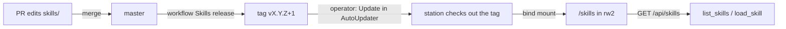

# Station skills: authoring

A station skill is a markdown file that a customer's Claude (Code or Desktop, stdio `mcp-rocketwelder`) reads with
`list_skills` and `load_skill`. It says how a part of RocketWelder works, how to do the job, and which MCP tool,
REST route or UI page to use.

## Location

| Where | Path |
|---|---|
| Source | `skills/<name>.md` in this repo, top level only (subfolders are not read) |
| Station | `./skills` bind-mounted read-only at `/skills` in the welder container (`docker-compose.yml`) |
| rw2 setting | `RocketWelder:Skills:Path`, default `/skills` (rw2 `Skills/SkillOptions.cs`) |

This file lives outside `skills/` because rw2 reads every top-level `*.md` there and logs a warning for a file without frontmatter.

## File format

```markdown
---
name: troubleshoot-devices
description: One sentence that lets Claude decide whether to load this skill.
triggers: [error 14, overlay is gone, camera not connected]
---
# Body: markdown, served verbatim by load_skill
```

| Field | Rule |
|---|---|
| `name` | Required. Equal to the file name without `.md`. rw2 removes a deleted skill by its file name. |
| `description` | Required. One sentence; shown by `list_skills`. |
| `triggers` | Optional. Phrases a person says when the skill applies. |

A file whose frontmatter is missing or is not valid YAML is skipped (rw2 `Skills/SkillLoader.cs`, warning in the welder log).

## Flow: merge to Claude



| Step | What happens |
|---|---|
| Merge | A push to `master` that touches `skills/**` runs `.github/workflows/skills-release.yml`. |
| Tag | If every file changed since the latest `vX.Y.Z` tag is under `skills/`, the workflow tags the next patch version. Otherwise it tags nothing and lists the other files in the job summary; the skills then ship with the next `release.sh` release. A pull request runs the same check as a dry run. |
| Station | The AutoUpdater shows the new tag. An operator applies it (Update button, or `POST /api/update/{packageName}` on the AutoUpdater). The update checks out the tag and runs `docker compose down` then `up -d`, so the welder restarts. |
| Serve | rw2 indexes `/skills/*.md` at start and on every file change. `GET /api/skills` lists them, `GET /api/skills/{name}` returns one body. |
| Claude | `list_skills` and `load_skill` on the rocketwelder MCP call those two routes on the selected station. |

## Testing a skill locally

1. Run rw2 with `RocketWelder__Skills__Path` set to your checkout's `skills/` folder (see the `test-rocketwelder` skill),
   or start rw2's `test-environments/epic-138-f002` with `E138F2_SKILLS_REF=<your branch>`.
2. `curl http://<rw2>/api/skills` lists your skill; `curl http://<rw2>/api/skills/<name>` returns its body.
   Missing from the list = bad frontmatter: read the welder log for `Skill file ... skipped`.
3. Register that rw2 in `mcp-rocketwelder` (`register_station`), start a fresh Claude session with only that MCP, ask the
   questions the skill must answer, and fix the skill until the answers are right.

## Rules

| Rule | Meaning |
|---|---|
| No customer names or parts | Generic cell words only. Cell-specific facts stay with that customer, never in a shipped skill. |
| No shell | The customer has no shell or SSH on the station. A skill sends Claude only to an MCP tool, a REST route reachable through the MCP / station URL, or a UI page the person opens. A missing read is named as a missing MCP tool (`docs/standards/mcp-tools.md`), never worked around. |
| Never move a real cell | A skill never tells Claude to move a robot on a real cell. |
| Code is the truth | Every tool, route, setting and page name is copied from the code of the release that serves the skill. |
| Every reference checked | A reviewer checks each tool, route, file and page reference against code before merge. |
| Not a copy of an epic | Distil how it works and how to do the job; link nothing Claude cannot open from the station. |
